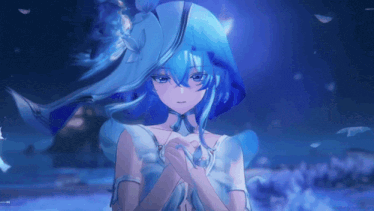
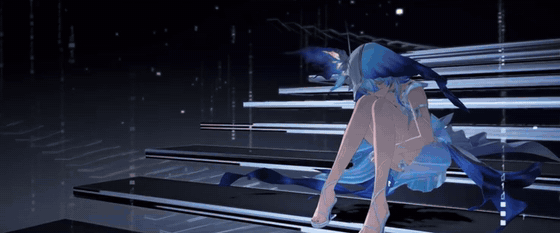

<!-- ========== BANNER ========== -->

<!-- ========== AVATAR (TODO: đổi href thành link portfolio khi có) ========== -->

# *— Keep the tide, ship the system —*

> 🦋 **`[ Tethys ]`** :: A new Resonator signal has reached the Black Shores. You are reading the log of **Nguyễn Đặng Quốc Anh** — *full-stack developer* by day, *IoT firmware tinkerer* when the boards light up, *data engineer* when the tide of events rolls in. *Stay a while, the stars are listening…*

 

<h3 align="center">✦ ＲＥＳＯＮＡＴＯＲ ／ ＰＲＯＦＩＬＥ ✦</h3>

<table>
  <tr><td>◆ <b>CLASS</b></td><td><code>::</code></td><td><code>FullStack Developer</code> @ <b>PureVita Trading &amp; Services Co., Ltd</b> · Truliva water purifiers</td></tr>
  <tr><td>◆ <b>RESONANCE</b></td><td><code>::</code></td><td><code>IoT Developer (collaborator)</code> @ <b>Truliva Quinyuan Group</b> · purifier chips &amp; firmware</td></tr>
  <tr><td>◆ <b>ACADEMY</b></td><td><code>::</code></td><td><code>Data Engineering</code> @ <b>HCMC University of Technology and Engineering (HCMUTE)</b></td></tr>
  <tr><td>◆ <b>BASE</b></td><td><code>::</code></td><td><code>Bình Thạnh, Ho Chi Minh City</code> · GMT+7</td></tr>
</table>

 

<h3 align="center">✦ ＥＣＨＯ ／ ＡＲＣＨＩＶＥ ✦</h3>

<table>
  <tr>
    <td width="50%" valign="top">
      <h4>💧 Truliva System</h4>
      <code>production</code> · <code>full-stack</code> · <code>90 active users</code>
      
Field-service management and mini-ERP for Truliva, used every day by <b>90 staff, including 78 field technicians</b>. Two-way order and stock sync with Pancake POS, smart technician dispatch, a PWA and Android app, push notifications and an analytics dashboard.

      
      
    </td>
    <td width="50%" valign="top">
      <h4>📡 Truliva IoT · TDS Decoder</h4>
      <code>iot</code> · <code>ESP32 firmware</code>
      
ESP-IDF firmware that sits inline between a purifier's main board and its display. It decodes the UART protocol to read TDS and the life of the PPC, RO and CTO filters, then serves a local web dashboard and sends Telegram alerts.

      
    </td>
  </tr>
  <tr>
    <td width="50%" valign="top">
      <h4>🌊 Real-Time Crypto Data Lakehouse</h4>
      <code>data engineering</code> · <code>streaming</code>
      
Streams the top 50 Binance USDT pairs over WebSocket through Kafka and Spark into a <b>Bronze → Silver → Gold</b> Delta Lake on GCS. Airflow orchestrates the pipeline, and Trino and Power BI serve the analytics.

      
    </td>
    <td width="50%" valign="top">
      <h4>📈 Crypto Analytics Platform</h4>
      <code>data engineering</code> · <code>docker</code>
      
A complete streaming pipeline that runs on one machine: Binance → Kafka → Spark Structured Streaming → Postgres and MinIO, with dbt transforms, Great Expectations checks, Airflow scheduling and Superset dashboards.

      
    </td>
  </tr>
  <tr>
    <td width="50%" valign="top">
      <h4>🧪 Cloud DWH Testing &amp; CI/CD</h4>
      <code>data warehouse</code> · <code>ci/cd</code>
      
A BigQuery star-schema warehouse built with dbt. Great Expectations tests every layer, GitHub Actions runs the whole pipeline with alerts to Discord, and a Streamlit app shows the results.

      
    </td>
    <td width="50%" valign="top">
      <h4>🏛️ Hương Độc Lập · Landing Page</h4>
      <code>frontend</code> · <code>scrollytelling</code> · <code>live</code>
      
A scrollytelling landing page for a multi-sensory night tour at the Independence Palace, with a Luxury Indochine look, built with Vite and vanilla JS.

      
    </td>
  </tr>
</table>

 

<h3 align="center">[ ／／ F O R T E _ A R S E N A L ／／ ]</h3>

<b>FULL-STACK</b> 
       

<b>MOBILE &amp; PLATFORMS</b> 
     

<b>IOT &amp; FIRMWARE</b> 
    

<b>DATA ENGINEERING</b> 
        

<b>SHIP &amp; RUN</b> 
    

 

<h3 align="center">[ ／／ T E T H Y S _ D A T A B A N K ／／ ]</h3>

  
   
  Refreshed daily · <a href="https://raw.githubusercontent.com/Quocanh1508/Quocanh1508/main/assets/github-dashboard-static.svg">View the still dashboard</a>

 

<h3 align="center">[ ／／ R E S O N A N C E _ L I N K ／／ ]</h3>

  
  
  <!-- TODO: bỏ comment khi có link
  
  
  -->

 

  

 

> *"Every commit is a star; the shore remembers them all."*

`// signal returned to the Black Shores`

